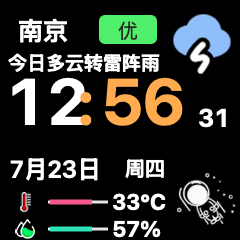

  

<h1 align="center">AI Mac 小屏幕</h1>

桌上的 240×240 天气与桌面信息屏 —— ESP8266 / ESP32-S3 · 开源硬件

  中文 · <a href="README.en.md">English</a>

  <a href="https://mac.qust.me">官网</a> ·
  <a href="https://mac.qust.me/#flash">网页刷机</a> ·
  <a href="https://github.com/pengchujin/esp8266-ai/releases/latest">下载</a>

  

一块复古小电视，默认显示天气时钟，也能切换音乐、股票和薪资进账页面。Mac 桥接支持 Wi-Fi 和 USB；Windows 桥接目前仅支持 Wi-Fi，且不提供天气数据与定位。设备自己保留配网、网页管理、亮度、OTA、电池和 IMU 旋转能力，Mac 桥接支持多设备。

## 功能

| | |
|---|---|
|  | **FuBoTV 原厂天气时钟** 复用原厂天气、温湿度和宇航员素材，显示天气、空气质量、时间日期、温度与湿度；支持 macOS 自动定位或手动城市，设备本地每秒更新秒针。 |
|  | **音乐播放显示** 专辑封面、歌名、歌手和进度实时同步；天气页播放音乐时自动切入，停止后自动返回。 |

还内置：

- **股票行情**：Mac 拉取腾讯行情，设备显示最多 5 只自选股的价格和涨跌幅，中文股票名走压缩二进制传输。
- **薪资时钟**：按 21.75 个法定计薪日折算每秒进账，支持月薪、上下班和午休设置，午休与周末自动暂停。
- **设备管理**：多设备记忆与自动配对、亮度、Wi-Fi 桥接地址、Web OTA、ESP32-S3 电池指示和 IMU 自动旋转。

## 快速上手

需要一台「SD2 小电视」开发板（[开源硬件](https://oshwhub.com/q21182889/sd2)，也可[购买成品](https://mobile.yangkeduo.com/goods.html?ps=OuPjGMWE82)）和一根 USB **数据**线。

1. 用 Chrome / Edge 打开 [网页刷机](https://mac.qust.me/#flash)，连接并烧录设备。
2. 首次开机连接热点 `AI-Clock-Setup`，在 `192.168.4.1` 选择家里 Wi-Fi。
3. 从 [Releases](https://github.com/pengchujin/esp8266-ai/releases/latest) 安装 macOS 或 Windows 桥接程序。

macOS 菜单栏左键打开实时镜像和亮度控制，右键打开设备选择、屏幕切换、功能开关、天气城市、自选股、薪资设置、桥接地址和 OTA 菜单。Windows 托盘提供设备发现与控制、屏幕切换、自选股和桥接设置。

同一局域网内设备会被自动发现并配对；Mac 的 USB 连接使用串口推送，适合开启客户端隔离的路由器或不想配置 Wi-Fi 的场景。桥接程序保留一个最小 `/status` 心跳，只包含时间戳和音乐播放状态；旧的 `auto`、`claude`、`codex`、`home`、`usage`、`info`、`net`、`pomodoro` 显示模式会安全迁移到默认天气页。

Mac 睡眠时桥接程序会暂停媒体、股票和天气轮询，唤醒后自动恢复。ESP32-S3 版本支持电池电量显示和 IMU 自动旋转，固件网页提供密码保护的 OTA 更新。

更多硬件、API 和构建细节见 [docs/DEVELOPMENT.md](docs/DEVELOPMENT.md)，Windows 说明见 [windows-app/README.md](windows-app/README.md)。

## 拓竹打印机状态（ESP8266 / ESP32-S3）

微雪 ESP32-S3-Touch-LCD-1.54 新增原生 LAN MQTT 打印机页，不依赖电脑保持运行。
这是本地源码新增功能，需要使用本项目构建的 App 和对应固件；上游网页刷机及 Releases 尚未包含本次改动。
显示进度、剩余时间、层数、喷嘴和热床温度，并适配 X2D 的左右喷嘴温度数据格式。
ESP8266 使用 Mac 桥接：Mac 连接打印机，通过 Wi-Fi 或 USB 发送精简状态给小电视。
电脑需保持开机且 App 正在运行；关闭监控或 Mac 睡眠时会断开打印机连接。
在 Mac 菜单栏右键选择 **打印机设置…**，填写打印机 IP、序列号和 LAN Access Code。
ESP8266 的访问码只存入 Mac 钥匙串；ESP32-S3 的配置页使用设备现有 OTA 认证，访问码存于设备。
访问码不要发到聊天或提交到 Git。首次配置需要明确确认是否信任打印机的自签名 TLS 证书。

仅支持局域网只读监控，不包含云账号登录、摄像头或打印控制。Windows 尚未实现打印机桥接。
番茄时钟已从固件、Mac 和 Windows 桥接中移除。完整配置、安全边界和参考来源见
[打印机说明](docs/PRINTER.md)。实际 X2D 连接与实体屏显示仍需使用你的设备验证。
